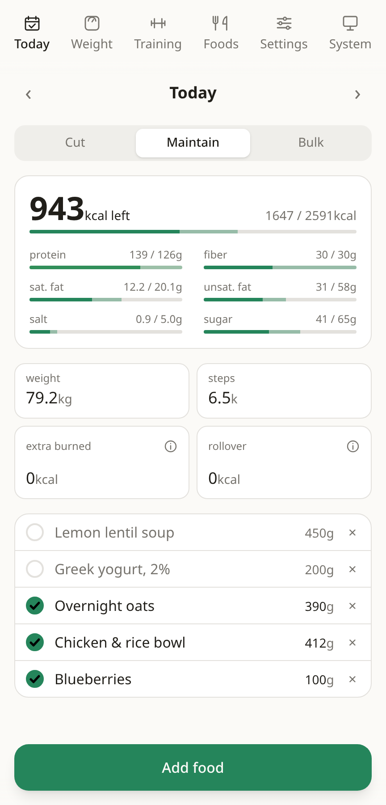

#  Regimen

A food, weight and workout tracker for Linux and Android. It works offline, keeps
everything in a folder you pick, and doesn't need an account or a server.

- Plan meals, tick off what you've eaten, and see your remaining calories and nutrients.
- Search bundled foods offline, including Greek search terms, or add your own.
- Save recipes and weigh each cooked batch to calculate nutrition per portion.
- Follow your weight trend and estimate maintenance calories from your logs.
- Save workouts and record sets, reps and weights.

<table>
  <tr>
    <th>Plan your day</th>
    <th>Follow your progress</th>
    <th>Keep your favourites</th>
  </tr>
  <tr>
    <td></td>
    <td></td>
    <td></td>
  </tr>
</table>

## Install on Linux

You need Node.js 22.12 or newer, pnpm, Rust and the
[Tauri prerequisites](https://v2.tauri.app/start/prerequisites/). From a clone of
this repository, run:

```sh
pnpm install
scripts/install-linux.sh
```

That puts `regimen` in `~/.local/bin` and adds it to your app launcher. Run the
script again to update.

## Install on Android

You need Android 11 or newer and a Regimen APK. To build one, see
[Build an Android APK](#build-an-android-apk).

Copy the APK to your phone and open it in your file manager. If Android asks,
allow installs from that file manager, then tap Install. Google's
[help page](https://support.google.com/pixelphone/answer/7391672#zippy=%2Cget-apps-from-other-sources)
shows where that setting is.

Or install it from your computer with [USB debugging](https://developer.android.com/studio/debug/dev-options)
turned on and the phone plugged in:

```sh
adb install -r regimen.apk
```

`-r` keeps your data when updating, as long as the new APK is signed with the
same key. Back up your data folder before uninstalling.

## First run

1. Pick a folder for your data. On Linux, type its full path.
2. Give the device a name, such as `phone` or `laptop`, and select Start.
3. Set your maintenance calories and targets in Settings, then add food on Today
   and tick it when you've eaten it.

To use Regimen on several devices, share the data folder between them with
[Syncthing](https://syncthing.net) and give each device a different name.
Regimen only saves locally, so logging offline is fine.

## Development

```sh
pnpm tauri dev   # desktop app with live reload
pnpm test
pnpm build
```

### Build an Android APK

Follow [Tauri's Android setup](https://v2.tauri.app/start/prerequisites/#android).
This project uses Android SDK Platform 37, and also needs Platform-Tools,
Build-Tools, Command-line Tools and the NDK from SDK Manager. Set `JAVA_HOME`,
`ANDROID_HOME` and `NDK_HOME`, then build:

```sh
rustup target add aarch64-linux-android
pnpm tauri android build --debug --apk --target aarch64
```

The APK lands under `src-tauri/gen/android/app/build/outputs/apk/`. Debug builds
are signed for local use. Release builds (without `--debug`) read their signing key
from `~/.local/share/android/regimen-release.properties` (`storeFile`, `keyAlias`,
`password`). Without that file the APK is unsigned and won't install. Keep the key
outside the repository.

## Food data

The offline food catalogue comes from USDA FoodData Central SR Legacy (public
domain), ANSES-CIQUAL 2020 (CC BY 4.0), and Open Food Facts products sold in Greece
(ODbL). You can edit any food once it's in your own list.

The catalogue is built by [`scripts/build_reference.py`](scripts/build_reference.py),
with corrections in [`scripts/food_cleanup.json`](scripts/food_cleanup.json), Greek
search terms in [`scripts/food_keywords.el.json`](scripts/food_keywords.el.json), and
a [review of the data](docs/food-review/README.md).
