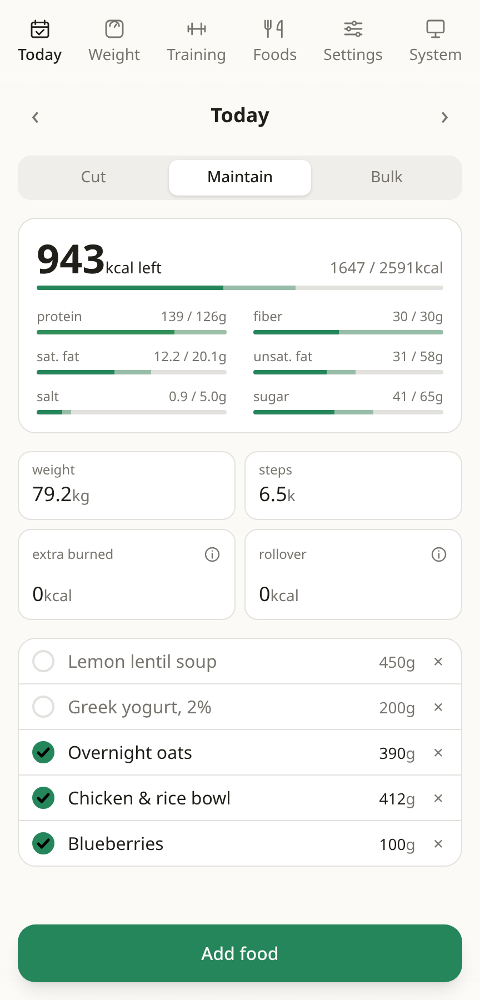
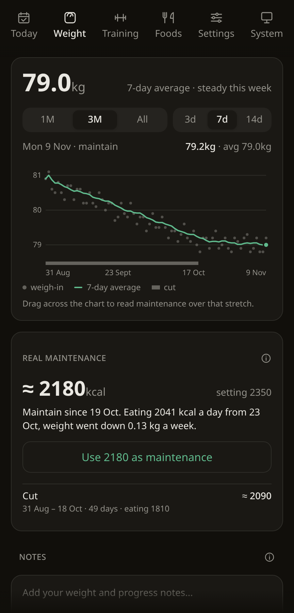
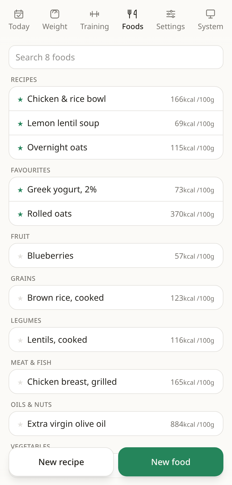

#  Regimen

Track your food, weight and workouts on Linux and Android. Regimen works offline,
keeps your data in a folder you control, and needs no account or server.

- Plan meals, tick off what you've eaten, and see your remaining calories and nutrients.
- Search bundled foods offline, including Greek search terms, or add your own.
- Save recipes and weigh each cooked batch to calculate nutrition per portion.
- Follow your weight trend and estimate maintenance calories from your logs.
- Save workouts and record sets, reps and weights.

## A look inside

<table>
  <tr>
    <th>Plan your day</th>
    <th>Follow your progress</th>
    <th>Keep your favourites</th>
  </tr>
  <tr>
    <td></td>
    <td></td>
    <td></td>
  </tr>
</table>

Screenshots use sample data in a browser preview. The app supports light and dark
themes with an adjustable accent colour.

## Install on Android

You'll need Android 11 or newer and a Regimen APK (the Android installation file).
If you're building it yourself, use the [build instructions below](#build-from-source).

### Install an APK on your phone

1. Copy the APK to your phone, then open it in your file manager.
2. If Android asks, open Settings and enable "Allow from this source" for that
   file manager. Return to the APK and tap Install.
3. Open Regimen and follow [the first-run setup](#first-run-and-sync).

This method uses the "Install unknown apps" permission. Developer options and
USB debugging are needed for the USB method below. See
[Google's APK installation instructions](https://support.google.com/pixelphone/answer/7391672#zippy=%2Cget-apps-from-other-sources)
if you can't find the permission. If Android specifically blocks an unverified
developer, follow [Google's additional setup steps](https://support.google.com/android/answer/17588095).

### Install from a computer over USB

1. On your phone, open Settings, then About phone. Find "Build number" (on Samsung,
   it's under "Software information"). Tap it seven times and enter your phone's
   PIN if asked. Android will confirm that Developer options are enabled.
2. Return to Settings and search for "Developer options". Open it and enable
   "USB debugging". Menu names vary by phone; see
   [Android's Developer options guide](https://developer.android.com/studio/debug/dev-options).
3. Connect the unlocked phone to your computer with a USB cable that supports
   data. Accept "Allow USB debugging?" on the phone to authorise your computer.
4. Install [Android SDK Platform-Tools](https://developer.android.com/tools/releases/platform-tools)
   on your computer, or your Linux distribution's `adb` package. With `adb` on
   your PATH, check the connection:

   ```sh
   adb devices
   ```

   Your phone should appear with `device` beside it. If it says `unauthorized`,
   unlock the phone and accept the debugging prompt. If the list is empty, try
   another data cable or USB port. For Linux permission errors or Windows USB
   drivers, follow [Android's device setup guide](https://developer.android.com/studio/run/device).

5. In the directory containing your APK, install it with the following command.
   Replace `regimen.apk` with your file's name:

   ```sh
   adb install -r regimen.apk
   ```

   Wait for `Success`, then open Regimen on the phone. If more than one device is
   connected, use `adb -s SERIAL install -r regimen.apk`, replacing `SERIAL` with
   the identifier shown by `adb devices`.

For updates, `-r` keeps the app's data. The APK must use the same signing key as
the installed version. If Android reports a signature mismatch, use a build signed
with the original key. Back up your data before considering an uninstall.
See the [ADB install reference](https://developer.android.com/tools/adb#move).

## First run and sync

1. Choose a folder for your data. On Android, use the folder picker and grant
   access. On Linux, enter the folder's full path.
2. Give each device a different name, such as `phone` and `laptop`. Use letters,
   digits, hyphens or underscores, then select Start.
3. Set your maintenance calories and nutrient targets in Settings. On Today,
   choose Cut, Maintain or Bulk, add your food, and tick it when eaten. You can
   also enter your weight and steps there.

To share data between devices, set up Syncthing separately on both, share the
data folder, and select that folder in Regimen on each device. Folder paths can
differ between devices. Regimen saves locally; Syncthing transfers changes when
the devices can connect. You can keep logging while offline.

For one device, a local folder is enough. Back it up to keep a separate copy of
your history. Folder and device settings are available in the System tab.

## Install on Linux

Linux installation currently builds from source. Install the prerequisites and
dependencies described below, then run this from the project directory:

```sh
scripts/install-linux.sh
```

Open Regimen from your application launcher. The script installs the app in
`~/.local/bin` and adds a launcher entry for your user. Run it again to update.

## Build from source

Built with Tauri 2, React, TypeScript and Tailwind. Start with Node.js 22.12 or
newer, pnpm, Rust, and the
[Tauri prerequisites for your platform](https://v2.tauri.app/start/prerequisites/).
Clone this repository, open its directory, then install the project dependencies:

```sh
pnpm install
```

<details>
<summary>Build an Android APK</summary>

Follow [Tauri's Android setup](https://v2.tauri.app/start/prerequisites/#android)
to install Android Studio, its JDK, and the Android SDK tools. This project uses
Android SDK Platform 37. In SDK Manager, also install Platform-Tools, Build-Tools,
Command-line Tools and NDK (Side by side).

Set `JAVA_HOME` to your JDK directory, `ANDROID_HOME` to the SDK location shown in
SDK Manager, and `NDK_HOME` to the installed version's directory inside the SDK's
`ndk` folder. The linked Tauri guide has platform-specific examples.

For a modern ARM64 phone, add the Rust target and build a debug APK:

```sh
rustup target add aarch64-linux-android
pnpm tauri android build --debug --apk --target aarch64
```

The APK is written under `src-tauri/gen/android/app/build/outputs/apk/`.
Use the path printed by the build with `adb install -r`, or copy the APK to your
phone. This build includes the app and works without a running development server.

Debug APKs are signed automatically for local use. Release builds
(`pnpm tauri android build --apk --target aarch64`) need a signing key: this
project reads `storeFile`, `keyAlias` and `password` from
`~/.local/share/android/regimen-release.properties`. Without it, the release APK
is unsigned and cannot be installed. See
[Android signing](https://v2.tauri.app/distribute/sign/android/) for creating a key;
keep the key and its passwords outside the repository.

</details>

<details>
<summary>Run locally and check changes</summary>

Run the desktop app with live reload:

```sh
pnpm tauri dev
```

For Android development, connect your phone with USB debugging enabled and run
`pnpm tauri android dev` after completing the Android toolchain setup above.

Run the app tests and check the frontend build:

```sh
pnpm test
pnpm build
```

</details>

## Food data

The offline food catalogue includes USDA FoodData Central SR Legacy (public
domain), ANSES-CIQUAL 2020 (CC BY 4.0), and Open Food Facts products sold in Greece
(ODbL). You can edit a food after adding it to your own list.

For catalogue maintenance, see the source downloads in
[`scripts/build_reference.py`](scripts/build_reference.py), reviewed corrections in
[`scripts/food_cleanup.json`](scripts/food_cleanup.json), and Greek search terms in
[`scripts/food_keywords.el.json`](scripts/food_keywords.el.json).
